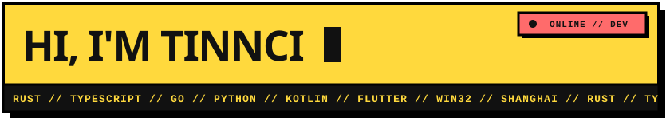

  

  <strong>Student &amp; Systems / Tooling Builder · Shanghai, China</strong>

  
  

---

### Featured Projects

| Project | Stack | Description |
| :--- | :---: | :--- |
| [**PecoFence**](https://github.com/Tinnci/PecoFence) | `Rust` | Open-source Stardock Fences alternative for Windows 11 — glass fences, live folders, tabs, Peek |
| [**maon**](https://github.com/Tinnci/maon) | `TypeScript` | Windows workspace for SPM models, changes, and builds |
| [**meegle-cli**](https://github.com/Tinnci/meegle-cli) | `Go` | CLI for Meegle (Lark Project) — manage work items, schedules, and data from the terminal |
| [**people-cli**](https://github.com/Tinnci/people-cli) | `Python` | Local-first people hub with source-aware identities, temporal facts, and extensible tagging |
| [**tinnci.github.io**](https://github.com/Tinnci/tinnci.github.io) | `TypeScript` | Personal website & technical troubleshooting notes |

---

### Tech Stack

  
  
  
  
  
  
  
  
  
  

---

### GitHub Activity

  

