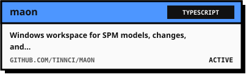
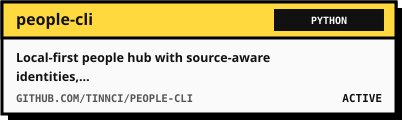
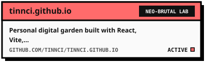

  

  
  
  
  

---

### `01 // FEATURED PROJECTS`

<table>
  <tr>
    <td align="center"></td>
    <td align="center"></td>
  </tr>
  <tr>
    <td align="center"></td>
    <td align="center"></td>
  </tr>
  <tr>
    <td align="center"></td>
    <td align="center"></td>
  </tr>
</table>

---

### `02 // TECH STACK`

  

---

### `03 // GITHUB ACTIVITY`

  

